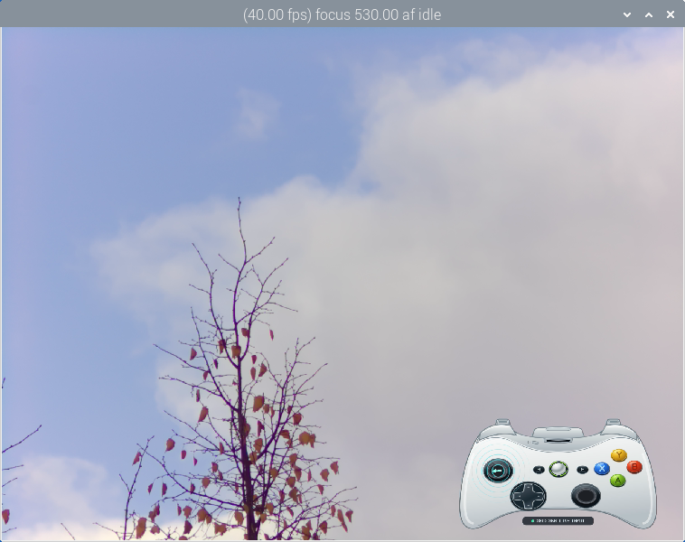

# Gamepad Overlay Post-Processing Stage

An rpicam-apps post-processing stage that renders a live Xbox 360 controller
overlay (buttons, analogue sticks, triggers, D-pad) onto the camera frame.

## Why?

In a live multi-camera or remotely controlled production, the camera operator
often drives **pan, tilt, focus and zoom** with the controller. From the outside
— and especially in the recorded or streamed picture — those control actions are
invisible: a viewer only sees the resulting camera movement, not *which* input
caused it.

The overlay makes the operator's control inputs visible by drawing a real-time
visualisation of the controller directly onto the video:

- which **face buttons** (A/B/X/Y), **bumpers** (LB/RB), **triggers** (LT/RT),
  **D-pad directions** and system buttons (Back/Start/Guide) are currently
  pressed — each press lights up the button and fires an expanding ring pulse,
  so a focus pull, a preset recall or a mode switch is instantly attributable;
- where the two **analogue sticks** are pointing — moving caps follow the real
  stick deflection and thus show a pan/tilt or zoom command in progress, and
  how far the **triggers** are pulled (fill-level bars);
- whether the controller is **connected** at all (status indicator), so a lost
  link or a disconnected device is immediately obvious in the picture.

Because the overlay is burned into the camera frame as a post-processing stage,
it travels with the video everywhere it goes — HDMI preview, network stream, or
recorded file — without any extra compositing step. In a review, a recording or
a live feed, a viewer can therefore see exactly which camera operation
(pan/tilt/focus/zoom) was triggered, by which input, at which moment.

The same overlay is also useful for **gameplay streams or recordings**: when a
game is played with the controller, a viewer can see which button or stick
movement produced which on-screen action — helpful in tutorials, speedruns, or
any video where the input should remain readable.

The stage is a **passive observer** of the joystick device:

- Opens `/dev/input/jsX` read-only (`O_RDONLY | O_NONBLOCK | O_CLOEXEC`).
- No `EVIOCGRAB`, no writing joystick ioctls, no `jscal`.
- Therefore runs side-by-side with other software (e.g. PTSApp+) using the
  same joystick.

## Preview



## Building

```bash
cd ~/rpicam-apps
meson setup build          # if not configured yet
ninja -C build
```

The stage is built as `build/post_processing_stages/gamepad-overlay-postproc.so`.
It requires `libcamera`, `librsvg-2.0` and `cairo` (present by default on
Raspberry Pi OS Bookworm).

## Installing

```bash
sudo cp build/post_processing_stages/gamepad-overlay-postproc.so \
        /usr/local/lib/aarch64-linux-gnu/rpicam-apps-postproc/
sudo cp assets/gamepad_overlay.json \
        /usr/local/share/rpi-camera-assets/
sudo cp assets/open_gamepad.svg assets/open_gamepad.LICENSE.txt \
        /usr/local/share/rpi-camera-assets/
```

The stage is loaded at runtime via `dlopen` from the post-processing library
directory; `ldconfig` is not required.

## Usage

```bash
rpicam-vid \
    --width 2028 --height 1520 --framerate 40 \
    --preview-backend qt -t 0 \
    --post-process-file /home/admin/rpicam-apps/assets/gamepad_overlay.json \
    --codec yuv420
```

`--post-process-file` points to the **JSON configuration**; the `.so` is loaded
separately from the install directory.

## Configuration (`assets/gamepad_overlay.json`)

| Key                  | Default          | Description                                           |
|----------------------|------------------|-------------------------------------------------------|
| `device`             | `/dev/input/js0` | Joystick device path                                  |
| `deadzone`           | `0.25`           | Deadzone (visual only, does not affect the controller)|
| `ring_lifetime_ms`   | `820`            | Lifetime of the ring animation per pulse (ms)         |
| `scale`              | `0.72`           | Overlay width as a fraction of the frame width        |
| `reconnect_delay_ms` | `1500`           | Delay before reopening after disconnection            |
| `position`           | `8`              | Position in the 3x3 grid (keypad layout, see below)   |
| `show_status`        | `true`           | Show the status bar, dot, text and error row; `false` hides them together |
| `hold_pulse_ms`      | `400`            | Repeat-pulse interval while an input is held          |
| `offset_x`           | `0`              | Horizontal pixel offset after grid placement          |
| `offset_y`           | `0`              | Vertical pixel offset after grid placement            |
| `svg_path`           | `/usr/local/share/rpi-camera-assets/open_gamepad.svg` | Path to the controller SVG |

The table lists the code defaults. The example JSON may override placement and
scale; keep your existing offsets when switching artwork.

### Position (`position`)

Keypad layout:

```
1 2 3     top-left · top-centre · top-right
4 5 6     mid-left · centre · mid-right
7 8 9     bottom-left · bottom-centre · bottom-right
```

Example: `"position": 2` places the overlay at the top centre.

## How it works

- **Input:** A background thread reads `struct js_event` and distinguishes
  `JS_EVENT_BUTTON`, `JS_EVENT_AXIS` and `JS_EVENT_INIT`. Events are drained
  until `EAGAIN`/`EWOULDBLOCK`; `EINTR` and disconnections are handled.
- **Animation:** A pulse of expanding rings starts on the "released → pressed"
  transition. Because joydev only reports state changes, the stage emits a
  repeat pulse every `hold_pulse_ms` while a button/stick is held.
  `JS_EVENT_INIT` does not trigger an animation.
- **Rendering:** The default controller artwork is an original geometric SVG
  (`assets/open_gamepad.svg`, CC0-1.0), rasterised with librsvg + cairo into a
  straight-alpha RGBA canvas. Visible pixels are blended directly into YUV420
  using the stream's YCbCr encoding and quantization range. Fully transparent
  2x2 blocks leave the frame byte-for-byte unchanged; mixed blocks preserve
  transparent pixels' luma and blend shared chroma by the four alpha values.
  Dynamic elements (button highlights, trigger fill level, D-pad, moving stick caps,
  rings) are mapped onto the SVG coordinates.
- **Stick direction:** A bright arrow on each active stick follows both axes,
  including diagonals, with the same vertical foreshortening as the cap. It is
  drawn after the pulse waves and stays visible while held. Stick pulses keep
  their waves but omit the opaque centre label that obscured the moving cap.
  Within the configured deadzone, the arrow is hidden.
- **Connection status:** The centred status bar is 420 x 50 logical pixels at
  (790,755), 30% narrower and two bar heights above its previous position.
  Text uses scale 2.6 instead of 2, with fractional pixel coverage for exactly
  30% larger glyphs. Both live and disconnected messages fit with the status dot.
  Set `"show_status": false` inside the `gamepad_overlay` JSON object to hide
  the entire status display, including its error row. Controller graphics and
  input animations remain visible. Restart the application after changing JSON.
- **Scaling:** `gamepad_overlay_resample.hpp` filters the complete RGBA canvas
  with coverage-weighted area averaging when shrinking. RGB is associated with
  alpha throughout both filter passes, then unassociated for YUV compositing.
  Pixel-centred interpolation is used for enlargement. Sampling weights and
  small row buffers are reused, and only the visible output region is stored.

### Why an SVG can still show stair steps

The compact SVG is rasterised once at 2000 x 781. The old compositor sampled just
four neighbouring pixels per output pixel, even during reduction. This is not
a full-area reduction filter and can miss thin strokes. `scale` is a fraction
of camera-frame width: for a 2028-pixel frame, 0.6 gives 1216 x 474 overlay pixels.
The new filter covers each destination pixel's entire source footprint,
including the dynamic highlights and stick caps.

The Qt preview adds a separate scale operation. In the referenced branch,
`QtPreview::Show()` uses nearest-neighbour-like sampling and shares chroma per
output pair. A small preview window can therefore look more jagged than the
encoded frame. The separate optional preview patch replaces this with area
filtering per YUV plane; it also enables smooth painting on window resize.
Its CPU/memory cost and frame rate need checking on the target Pi.

## Editing the artwork

`open_gamepad.svg` depicts a white Xbox 360 Wireless controller in an oblique
front/upper view based on the supplied photograph's perspective. All shoulder
buttons and triggers are visible; projected controls and live stick caps are
elliptical. The photograph's black shell colour is not used.

It is an independent drawing made from simple paths and shapes;
it does not reuse the previous artwork's paths or logos. The file has a transparent
background, named groups and no external images or fonts. Its CC0-1.0 dedication
allows modification and redistribution, including commercial use, without
attribution or share-alike requirements. See `assets/open_gamepad.LICENSE.txt`
and <https://creativecommons.org/publicdomain/zero/1.0/>.

Keep `viewBox="0 144 2000 781"` and the logical control centres when changing the style.
The 144-unit top crop is also applied by the Canvas, so artwork, masks and effects
stay aligned. The loader retains logical alignment for 2000-wide SVG viewBoxes,
including the earlier full 2000 x 925 viewBox.

The upper right controls reuse reflected left-side geometry about x=1000.
Trigger centres are `(675,200)` and `(1325,200)`; bumper centres are `(656,264)`
and `(1344,264)`. Keep IDs `button-lb`, `button-rb`, `trigger-left-meter` and
`trigger-right-meter`: their rendered alpha is cropped into small runtime masks,
so shoulder highlights and partial trigger fills follow the actual SVG contours.
This requires the existing librsvg 2.46+ rendering API, with no new dependency.

The C++ stage draws moving stick caps and input effects on top. The caps move
20 logical units horizontally and 15 vertically to stay within the projected
wells, with radial limiting for simultaneous maximum X/Y; this only changes the
visualisation, not joystick input. If you move a
control in the SVG, also update `buttonPosition`, `axisHotspot`, `stickPosition`
and the trigger positions in `drawHighlights` as applicable.

## Limitations

- Only the YUV420 format of the main stream is supported.
- A camera/joystick smoke test is required after rebuilding on the target Pi.
- The previous `assets/360_controller.svg`, if retained in the source tree or
  an older installation, keeps its original CC BY-SA 3.0 terms. It is no longer
  selected or installed by this stage; the CC0 dedication applies only to the
  new artwork.
