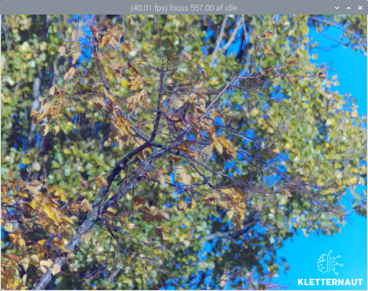

# svg_overlay — configurable SVG logo post-processing stage

Status: 2026-10-30. This stage composites a configurable SVG graphic (e.g. a
logo) into the main image of rpicam-apps. Position, size and transparency come
from the JSON configuration; in the Qt preview the logo area is optionally
clickable and opens a URL.

## Features

- **One-time rasterisation:** The SVG is rasterised only once at startup in
  `Configure()` (librsvg + cairo). Each frame only performs an alpha blend of
  the precomputed pixel image — no SVG parsing cost in the live stream.
- **Anchor semantics without surprises:** `x`/`y` are 0..1, where
  `0` = flush left/top and `1` = flush right/bottom. Values in between scale
  linearly across the remaining space. No combination can push the logo out
  of the frame — no startup crash possible.
- **Height follows the aspect ratio:** `width` is the actual logo width
  relative to the image; the height is derived automatically from the SVG's
  aspect ratio. A `height` key is ignored (log notice).
- **Edge smoothing:** The SVG is rasterised at a reference resolution and
  scaled down with area averaging (alpha-correct, same approach as the
  gamepad stage). Thin outlines survive the downscale.
- **Clickable URL (Qt preview):** Optionally, a left click on the logo area
  opens an `http(s)` URL in the browser. In recorded videos the URL is, of
  course, not clickable.
- **Clean YUV420 blend:** luma per pixel, chroma per shared 2x2 block, taking
  the stream colour space into account (BT.601/709/2020, limited/full).

## Build

The stage is built as a separate module `svg-overlay-postproc.so`. It is
optional: without `librsvg2-dev`/`libcairo2-dev` it is skipped and the rest of
rpicam-apps builds normally.

```sh
sudo apt install librsvg2-dev libcairo2-dev
meson setup build --reconfigure
ninja -C build
sudo meson install -C build
```

## Preview



## Configuration

Example (`assets/svg_overlay.json`):

```json
{
    "svg_overlay": {
        "svg_path": "/usr/local/share/rpi-camera-assets/sample_logo.svg",
        "x": 0.43,
        "y": 0.02,
        "width": 0.14,
        "opacity": 0.85,
        "url": "https://example.com"
    }
}
```

| Key | Range | Meaning |
|---|---|---|
| `svg_path` | path | SVG file (required) |
| `x`, `y` | 0..1 | anchor: 0 = flush left/top, 1 = flush right/bottom |
| `width` | 0..1 | actual logo width as a fraction of the image width |
| `opacity` | 0..1 | global opacity, multiplied with the SVG alpha |
| `url` | optional | `http(s)` target for the click in the Qt preview |

Run:

```sh
rpicam-vid -t 0 --post-process-file /usr/local/share/rpi-camera-assets/svg_overlay.json
```

## Files

- `post_processing_stages/svg_overlay_stage.cpp` — stage implementation
- `post_processing_stages/meson.build` — module build (`svg-overlay-postproc` section)
- `assets/svg_overlay.json` — example configuration
- `assets/sample_logo.svg` — example logo
- `preview/preview_plane_resample.hpp` — filtered resampling stages for the
  logo area in the Qt preview (the full frame stays on the fast
  nearest-neighbour path)
- `docs/svg-overlay-stage.md` — technical documentation

## Notes

- The clickable area matches the configured logo rectangle in the preview;
  the URL only applies in the live preview (`--preview-backend qt`).
- The SVG aspect ratio is read from the intrinsic dimensions; if they are
  missing, a square is assumed.
